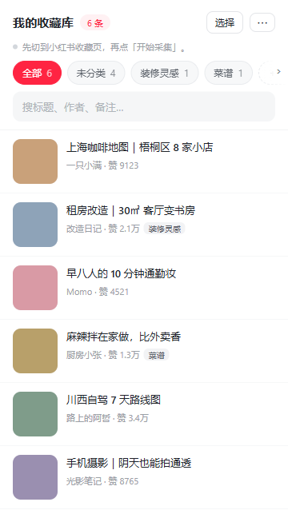

# 小红书收藏库（浏览器扩展）

把自己的小红书的收藏抓下来，在**本机**做文件夹归类、写备注、搜内容、导 CSV。



> **非官方项目**，与小红书官方无关。只操作**你自己账号**的数据，采集走的是你已登录页面自己的请求，不破解、不绕过风控。
> 唯一的写操作是「删除文件夹 → 逐条取消收藏」，节奏刻意做成人手速度，可随时停下（见下文）。请自行判断使用风险，遵守平台规则。

**唯一的写回操作**：删除文件夹时，会把里面的收藏逐条**取消收藏**（慢速、可熔断，见下文「删除文件夹 = 同步取消收藏」）。除这一项外，插件从不替你收藏、移动或改专辑。

**隐私**：收藏数据只存在你自己浏览器的 IndexedDB 里，不上传任何服务器。唯一对外发送的是「标题 + 作者」——而且只在你主动点「AI 自动归类」时发给 DeepSeek（用你自己的 Key），可以在设置里清空 Key 停用。

## 功能

| 功能 | 说明 |
|---|---|
| 采集 | 打开收藏页点一下，页面自动往下滚，按目标条数（当前 100）抓进本地库 |
| 文件夹 | 自己建文件夹，一条可以归到一个文件夹，也可以一直放着不归；**上限 10 个**（类目太多分类效果反而差） |
| 备注 | 每条可以写一句话，搜索能搜到，导出会带上 |
| 搜索 | 搜标题、作者、备注，和文件夹筛选叠加生效 |
| 多选批量 | 勾选若干条，一次性移到某个文件夹，或只导出这几条；底栏支持**全选 / 全不选**（作用于当前筛选结果） |
| 导出 CSV | 存到系统下载文件夹，带 BOM，Excel 打开不乱码 |
| 采集提示 | 采完若有未分类，顶部浮一条「还有 N 条未分类」：**N ≥ 10 直接开跑 AI 归类**，N < 10 才进手动多选（条数少时手动更快） |
| AI 归类 | 让 DeepSeek 看标题，建议每条该进哪个文件夹；你勾选确认后才写本地 |

## 安装（Chrome / Edge，开发者模式）

这个扩展**不上架应用商店**，用「加载已解压」的方式装：

1. 右上角 `Code → Download ZIP` 下载本仓库并解压（或 `git clone`）
2. Chrome 地址栏输入 `chrome://extensions/` 回车；Edge 输入 `edge://extensions/`
3. 打开「开发者模式」（Edge 在左侧栏）
4. 点「加载已解压的扩展程序 / 加载解压缩的扩展」，选择**解压出来、里面有 `manifest.json` 的那一层文件夹**
5. 点工具栏的扩展图标，把它固定（Pin）出来，点一下就在侧边栏打开面板

> 要求 Chrome 114+ / Edge 114+（用到 `chrome.sidePanel` 侧边栏 API）。升级扩展代码后，要在扩展卡片上点一次「刷新」，并 **F5 刷新小红书页面**（页面里跑的是注入脚本，不刷新还是旧的）。

## 使用

**采集**

1. 登录小红书网页版，打开收藏页：
   `https://www.xiaohongshu.com/user/profile/<uid>?tab=fav&subTab=note`
2. **在收藏页按一次 F5**。采集靠旁路捕获页面自己发的请求，不刷新会漏掉已加载的页。
3. 点扩展图标打开面板 → 右上 `⋯` →「开始采集」。
4. 保持这个标签页在前台，页面会自动往下滚。状态行显示「采集中 37 / 100 条」。
5. 结束后显示结束原因（达标 / 到底 / 手动 / 超时）与本次条数。

注意：**不点「开始采集」时，怎么滚收藏页都不会写库**——页面自己发的收藏流只进一个 10 分钟的滚动缓冲，点「开始采集」时才把缓冲补录进去（这样 F5 后页面自动加载的第一屏也能被采到）。

**整理**

- 顶部一排 chips：`全部 / 未分类 / 各文件夹 / ＋新建`，点哪个看哪个。文件夹多了这排会**横向滑动**：鼠标滚轮直接滑、按住左右拖、或点两端的 `‹ ›` 翻页；切换文件夹时选中的那个会自动滚进视野
- 点任意一条 → 右侧滑出详情：选文件夹、写备注，点「保存」生效；详情里也有**「取消收藏」**按钮——这条立即从列表隐藏，并在小红书逐条取消收藏（进度看红色进度条）
- 点右上「选择」→ 每条前面出现圆圈 → 勾选后底部升起黑条：第一行 `已选 N 条 · 全选/全不选`，第二行 `移动 / 导出 / 取消收藏 / 取消`
- 顶部提示条「还有 N 条未分类」：`N ≥ 10` 时按钮是「AI 自动整理 →」，点了直接开跑 AI 规划归类；`N < 10` 时是「去整理 →」，进未分类多选
- 「移动 x 条到」弹窗：圆圈靠左、文件夹名靠右，长名字省略号截断不换行
- 右上 `⋯` →「管理文件夹」可改名、删除；**删除文件夹 = 笔记隐藏排队 + 在小红书上逐条取消收藏**（见下）
- 浮层是分层的：`管理文件夹` / `AI 自动归类` / `设置` 都从 `⋯ 更多操作` 里进，点左上角 `‹` **回到「更多操作」**（不是一路退回列表首页）；再点一次 `‹` 才收起全部浮层。从提示条直接打开的 AI 面板则一次退回列表

**取消收藏的进度看哪**

删除文件夹、详情页取消收藏、批量取消收藏之后，列表上方会出现一条**红色进度条**：

- 进行中：`正在同步取消收藏到小红书：3 / 10 条 · 剩 7 条`，带进度条；下面一行实时显示当前在做什么（`当前：等收藏按钮出现 / 点击取消收藏 / 等页面确认结果`），一条通常 2~4 秒
- 暂停/失败：显示原因和剩余条数，带「续跑 →」按钮
- 完成：`✅ 取消收藏完成：共 N 条`，点最右边的 × 收起
- 重开面板也能接上进度（面板会向后台查询当前同步状态）
- **跑完自己回到原页面**：开始同步前你停在哪个小红书页面（收藏页 / 个人主页），全部跑完后标签页会被导航回去——小红书笔记页在取消收藏后常自己跳回首页，扩展会把这一跳纠正回来。若开始前本来就在某篇笔记的详情页，则不额外跳转

**导出**

`⋯` →「导出 CSV」，或勾选后点底栏「导出」。文件名形如 `xhs-fav-全部-20261112.csv`，落在系统下载文件夹。
字段：标题 / 作者 / 点赞 / 文件夹 / 备注 / 链接。

**AI 归类**

`⋯` →「AI 自动归类」→「开始分析」。

- 只处理**未分类**的收藏，一次最多 60 条（每 20 条一批）
- **不需要先建文件夹**：AI 分两步走——先看这批标题**自己规划一套文件夹**（合适的现有文件夹复用，缺的新建，总数 3~10 个），再把每条分进去；新建文件夹点确认时自动创建
- 发出去的内容只有**标题和作者**，不发封面、链接、备注
- 满 10 个文件夹后不再新建（复用现有）；代码层 `parsePlan` + `capNewFolders` 双重兜底裁剪，确认时也再拦一次
- 分析完列出建议：`→ 装修灵感 · 很确定`，**全部自动勾选**，点一次「确认归类」完成；个别不想动的先勾掉，没建议的行压暗、勾选框禁用（明确表示「保持未分类」）
- 置信度只用三档（很确定 ≥85 / 可能 ≥60 / 存疑），不用精确百分数——模型对自己准不准估得并不准
- 确认前不写任何东西，中途点「停止」也不留痕；只改本地，**不碰小红书**

**Key 放哪**

AI 归类要你自己的 DeepSeek Key（[在这里申请](https://platform.deepseek.com/api_keys)，按量计费，一次 60 条约几厘钱）。仓库里**不含任何 Key**，两种填法：

1. **面板里填**（推荐）：`⋯ → 设置` 粘贴 Key，存在 `chrome.storage.local`，随时能改也能清空。填过之后 `src/config.js` 就不用管。
2. **固定在代码里**（只在自己的电脑上用）：新建 `src/config.local.js`，内容一行
   ```js
   export const DEFAULT_DEEPSEEK_KEY = "sk-你的key";
   ```
   这个文件名已经写进 `.gitignore`，不会被提交；忘了哪天误提交，`git status` 里也不会出现它。

Key 只用于直连 `api.deepseek.com`，不经过任何中转；发出去的内容只有标题和作者。

## 数据规则

- **文件夹**是纯本地概念，和小红书专辑没有任何关系；你在插件里怎么分都不会影响账号
- **未分类**就是「还没归到任何文件夹」，可以一直放着，不影响任何事
- **删除文件夹** = 文件夹壳移除，里面的笔记标记 `pendingUnfav`（列表里立即隐藏，但记录和 `xsec_token` 保留着供打开笔记页用），笔记 id 进「待取消收藏」队列，由后台在小红书页面打开时逐条慢速取消收藏；**成功一条才真删一条**；任何一条失败立即全线停止（熔断）；没取消成功的仍收藏在小红书，下次采集会自动回到插件，不会丢；队列里已查无此记录的 id（早就取消过的残留）会自动跳过出队
- 采集是增量合并的：已存在条目只更新点赞数和采集时间，**文件夹、备注永不被覆盖**

## 已实测的接口事实（2026-11-12）

| 项 | 值 |
|---|---|
| 收藏流接口 | `//edith.xiaohongshu.com/api/sns/web/v2/note/collect/page` |
| 参数 | `num=30&cursor=<20位hex>&user_id=<uid>&image_formats=jpg,webp,avif` |
| 分页 | 靠响应 `data.cursor` 回传，`data.has_more` 为 false 表示到底 |
| 每页 | 30 条 |
| 滚动容器 | `document.scrollingElement`（html），`window.scrollTo` 有效 |
| 单条结构 | 扁平，无 `note_card` 包裹：`note_id / display_title / type / xsec_token / user{user_id,nickname} / interact_info{liked_count} / cover{url_pre,url_default,info_list[]}` |
| 封面地址 | 接口返回 `http://sns-webpic-qc.xhscdn.com/...`，扩展页是安全上下文，会被混合内容策略拦掉，写入前必须升成 `https://` |
| 干扰项 | `t2.xiaohongshu.com/api/v2/collect` 是埋点上报（base64 protobuf），不是收藏接口；`apm-fe.xiaohongshu.com/api/data` 是性能上报 |

## 删除文件夹 = 同步取消收藏（2026-11-13 定稿：UI 模拟真人操作）

用户明确要求：删文件夹时，里面的收藏要**真的取消收藏**，不只是本地移走。

⚠️ 为什么必须用 UI 模拟：2026-11-13 实测（真实登录态浏览器）——直调 `note/uncollect` 接口**无论签名头多齐全都过不去**：页面真实请求带 5 个签名相关头（X-s / X-t / X-S-Common / x-b3-traceid / x-xray-traceid），原样重放也返回 406（签名与请求强时效绑定）；用页面自己的 `window._webmsxyw` 现算 X-s/X-t 能过格式关，但被风控引擎以 461「账号异常」拒绝。结论：直调 API 此路不通，**唯一可靠做法是让页面自己的代码发请求**——扩展只负责像人一样打开笔记页、点一下「已收藏」按钮。

| 项 | 设计 |
|---|---|
| 触发 | 三个入口：①「管理文件夹 → 删除」（文件夹壳移除 + 整批入队）；②笔记详情页「取消收藏」（单条）；③多选底栏「取消收藏」（批量）。都写入持久化队列（IndexedDB meta），笔记标记 `pendingUnfav`（列表立即隐藏、记录与 token 保留） |
| 进度 | 面板里常驻**红色进度条**：进行中显示 x/y 与剩余、带进度条；暂停/失败显示原因和「续跑 →」；完成打 ✅。面板重开时向后台查 `xhsfav-sync-status` 接上进度 |
| 执行 | 面板 → 后台逐条 `chrome.tabs.update` 导航到笔记详情页（`/user/profile/<uid>/<noteId>?xsec_token=...&xsec_source=`，token 采集时已入库）→ 导航后每 200ms 探测页面脚本，**一就绪立刻下发指令（不等 `load` 事件）** → inject（页面 MAIN world）轮询等「收藏」按钮渲染出来（100ms 一次）→ JS 派发 mousedown/mouseup/click → **页面自己的代码签名发请求**，扩展只旁路捕获响应确认 `code:0` |
| 速度 | 单条约 **2~4 秒**。实测小红书笔记页 `DOMContentLoaded` 1.7 秒、`load` 竟要 8 秒（按钮 1~2 秒就渲染好了），旧实现等 `load` 才动手，一条要 10 秒——这就是「卡住」的真相；现在脚本就绪就点，不再干等 |
| 状态判定 | 按钮图标 `use[href="#collected"]`=已收藏、`#collect`=未收藏；打开时已是 `#collect` 会隔 600ms 再确认一次（防骨架屏误判）才视为完成 |
| 点空保护 | 点完 2.5 秒没等到请求、且图标**仍是已收藏**才补点一次；图标已变未收藏绝不再点（否则会重新收藏回去）；同一条的重复指令只执行一次（快速驱动 + load 兜底两路并发） |
| 节流 | 每条处理完随机歇 1.5~3 秒再处理下一条——模拟人手节奏 |
| 熔断 | 任何一条失败、页面脚本连不上（提示去 F5）、当前条目 90 秒无动静（看门狗）都立即停止，剩余留在队列；「续跑 →」或 `⋯ → 续跑取消收藏` 可续跑 |
| 跳过 | 队列里查无此记录 / 缺 token / 缺 uid 的 id 自动跳过出队（多是早已取消成功的残留） |
| 自愈 | 没取消成功的笔记仍收藏在小红书，**下次采集会自动回到插件**，不会丢数据 |
| 手动入口 | 进度条「续跑 →」、`⋯ → 续跑取消收藏`；队列空时提示「没有待取消收藏的条目」 |
| 排查 | 每一跳都打 `[xhsfav]` 日志：页面侧看 F12 Console，后台侧看 Service Worker 控制台 |

**2026-11-13 已在真实浏览器端到端验证**：10 条真实队列逐条导航 + 点击，全部返回 `{"code":0,"success":true,"msg":"成功"}`，收藏数 1035→1025。仍然注意：**必须保持登录**（游客态一切请求都被拒），重载扩展后要 F5 刷新小红书页面（否则页面里跑的还是旧脚本，会报「连不上页面脚本」）。

## 为什么不写回小红书（实测记录）

产品上曾要求「插件里分好类，小红书专辑也跟着变」。实际测下来这条路在网页端走不通：

| 项 | 实测结果 |
|---|---|
| 专辑子标签 | 路由是 `subTab=board` |
| 专辑列表接口 | `//edith.xiaohongshu.com/api/sns/web/v1/board/user?user_id=<uid>&page=1&num=30` |
| 网页版新建专辑 | **没有入口**，专辑页空状态只有「你还没有创建过专辑」 |
| 收藏页批量移动 | **没有**多选、没有批量操作 |
| 单条「加入专辑」 | 只在刚收藏成功后闪现一个面板，2 秒自动消失，第二次收藏不再出现 |
| 收藏 / 取消收藏接口 | `POST .../v1/note/collect` body `{"note_id":"<id>"}`；`.../note/uncollect` body `{"note_ids":"<id>"}` |
| 签名 | 页面暴露 `window._webmsxyw(path, data)` → `{X-s, X-t}`，另外还要固定 `X-S-Common` 头 |
| 自算签名直调接口 | **失败**：`HTTP 461 / code 300011 当前账号存在异常，请切换账号后重试` |
| 自动化点页面 | **触发风控**：几次「取消收藏→收藏」后网页登录态被踢出，需要重新扫码 |
| 扩展直调 uncollect（带全套签名头） | **失败**：原样重放页面自己的头 → 406；`_webmsxyw` 现算签名 → 461「账号异常」（2026-11-13 登录态实测，直调 API 路线彻底放弃） |
| UI 模拟点「已收藏」按钮 | **成功**：页面自己的代码签名发请求，逐条 `code:0`（2026-11-13 真实清空 10 条队列验证） |

结论：专辑写回这条路走不通（无入口、无批量），产品定为**纯本地**；唯一的例外是上面「删除文件夹 = 同步取消收藏」——这是有意的取舍（用户明确要「删了就真的取消收藏」），并且带节流、熔断、自愈三重护栏。

## 采集不到时怎么排查

收藏是个人主页的子标签（`subTab=note` 笔记、`subTab=board` 专辑），不是独立路由。

在该页按 F12：

1. Console 应看到 `[xhsfav] 捕获收藏流 30 条`，每滚一屏出现一次。没有 → 去 `chrome://extensions/` 点刷新，再 F5 刷新页面。
2. 有日志但面板不涨 → 后台写库失败，点扩展卡片上的「错误」看 Service Worker 报错。
3. 日志条数一直是 0 → 响应结构变了，对照上面「已实测的接口事实」检查字段名。
4. 列表全是灰块 → 封面没升 https，检查 `db.js` 里 `extractNote` 的 cover 处理。

## 开发说明

扩展本体**零依赖**（原生 JS + IndexedDB，没有构建步骤）：改完源码去 `chrome://extensions/` 点一次刷新即可，改页面注入脚本要再 F5 一次小红书页面。

代码结构：

| 文件 | 作用 |
|---|---|
| `src/inject.js` | 注入到页面 MAIN world（`document_start`）：旁路捕获收藏流；取消收藏时模拟真人点按钮 |
| `src/bridge.js` | 隔离世界的中转：页面 ↔ 扩展之间的消息桥，顺带把当前 uid 报给后台 |
| `src/background.js` | Service Worker：采集写库、取消收藏队列的导航与节奏编排、看门狗 |
| `src/db.js` | IndexedDB 封装（笔记 / 文件夹 / 队列 / meta），增量合并、封面地址升 https |
| `src/ai.js` | DeepSeek 两步归类：先规划文件夹，再逐条分配；严格解析 + 越界裁剪 |
| `src/panel/*` | 侧边栏 UI（原生 DOM，无框架） |
| `src/config.js` | 模型名、文件夹上限；**不含 Key** |

面板逻辑有 **211 项自动化测试**（jsdom + fake-indexeddb 跑真实的面板代码，真 DOM、真 IndexedDB，只把 `chrome.*` 换成桩），不需要浏览器、不联网、不花钱：

```bash
npm install      # 只装测试用的 devDependencies（扩展本体没有依赖）
npm test
```

覆盖渲染 / 筛选 / 搜索 / 详情 / 批量移动与全选 / 导出 CSV / 文件夹增删与上限 / 提示条与 AI 阈值 / AI 两步规划与解析降级 / 取消收藏全链路（导航→点击→出队→熔断→回原页面）/ 单条与批量取消收藏 / 采集门控 / 浮层层级 / 标签栏横滑。

测试也不依赖任何真 Key——Key 用桩注入 `chrome.storage`，AI 请求用 `fetch` 桩，所以拉下来就能跑。

## 已知限制

- 只在 Chrome / Edge 桌面版验证过；Firefox 的 MV3 与 `sidePanel` 不兼容这套写法
- 采集靠捕获页面自己的请求，**平台改字段就会失效**（改法见上面「已实测的接口事实」）
- 文件夹上限 10 个；单次 AI 最多处理 60 条未分类
- 取消收藏必须保持登录，且那个标签页要一直开着

## 参与 / 反馈

发现问题请开 Issue，附上：Chrome 版本、`chrome://extensions` 里扩展有没有报错、F12 Console 里 `[xhsfav]` 开头的日志。改动欢迎 PR，但请保持「零依赖、无构建步骤」。

## License

[MIT](LICENSE)

## 里程碑

- M1 采集链路：✅ 旁路捕获 → IndexedDB → 列表与搜索
- M2 本地整理：✅ 文件夹、备注、批量移动、导出 CSV、采集后提示
- M3 AI 归类：✅ DeepSeek 判标题，建议三档置信度，勾选确认后只写本地库

## 边界

只操作本人账号的数据。唯一的写操作是「删除文件夹 → 逐条取消收藏」（用户明确要求，带节流/熔断/自愈护栏）；不绕过平台风控，节奏刻意保持人类速度。对外发送的敏感内容只有「标题 + 作者」到 DeepSeek 用于分类，可用「设置」清空 Key 后停用。仅供个人使用，不上架应用商店。
